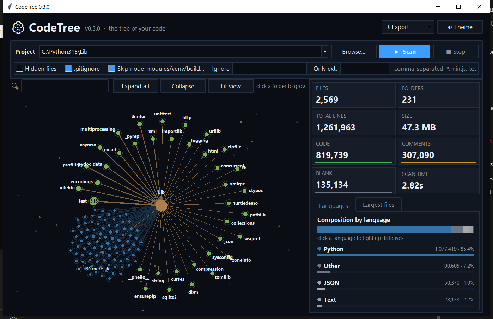

<div align="center">

# 🌳 CodeTree

**See your codebase as a living, animated tree.**

Folders grow into branches, files bloom as leaves — sized by lines of code, colored by language.

[](https://pypi.org/project/codetree-cli/)
[](https://www.python.org/)
[](LICENSE)
[](#installation)
[](#why-codetree)



</div>

---

## Why CodeTree?

Line counters give you a table. CodeTree gives you a **map**: you instantly see which folders are heavy, which files dominate, and how comments, blank lines and code are balanced — and you can explore it by clicking, zooming and searching.

- 🌱 **A tree, not a table** — an animated radial tree that grows from the trunk outward.
- 🎨 **Language-aware** — 40+ languages detected, every line classified as *code*, *comment* or *blank*.
- ⚡ **Fast** — scans thousands of files in a couple of seconds, in the background, with a live progress view.
- 🧰 **Zero dependencies** — pure Python standard library (Tkinter for the GUI).
- 🖥️ **GUI by default, terminal when you need it** — scriptable with JSON / CSV / Markdown export.

## Installation

```bash
pip install codetree-cli
```

From source:

```bash
git clone https://github.com/rezamardani01/codetree.git
cd codetree
pip install .
```

> Requires Python 3.8+. The GUI uses Tkinter, which ships with the official Python installers
> (on some Linux distributions install it with e.g. `sudo apt install python3-tk`).

## Usage

```bash
codetree                  # open the GUI on the current folder
codetree path/to/project  # open the GUI on a specific folder
codetree-gui              # same, without a console window on Windows
```

### In the window

| Action | What it does |
|---|---|
| **Click a folder** | Grow or fold its branch (animated) |
| **Drag / mouse wheel** | Pan / zoom |
| **Hover a node** | Highlights its path to the trunk and shows lines, code/comment/blank split, size and share of the project |
| **Double-click a file** | Opens it in your default editor |
| **Right-click** | Open, show in folder, copy path |
| **Search box** | Prunes the tree to matching files and folders |
| **Click a language** | Lights up all leaves written in it |
| **Click a file in "Largest files"** | Flies the camera to that leaf |
| **Expand all · Collapse · Fit view** | Overview controls |
| **Theme · Export** | Dark/light theme, export JSON / CSV / Markdown |

Shortcuts: `F5` rescan · `Ctrl+O` browse · `Ctrl+F` search · `Ctrl+E` export JSON · `Esc` clear search.

### Reading the tree

- **Trunk** (center) = the project root.
- **Branches / green nodes** = folders. Thicker branch = more lines. The number on a folded node is how many items it hides.
- **Leaves** = files, arranged in a sunflower pattern at the end of their branch. **Bigger leaf = more lines. Color = language.**

### Terminal mode

```bash
codetree --cli                          # tree + language table + summary
codetree --cli --depth 2 --sort lines   # limit depth, biggest first
codetree --cli --top 10                 # also list the 10 largest files
codetree -e py -e js -i "*.min.js"      # only these extensions, ignore a pattern
codetree --json report.json             # write reports (use - for stdout)
codetree --csv report.csv --md report.md
```

| Option | Description |
|---|---|
| `--cli` | Print to the terminal instead of opening the GUI |
| `--json / --csv / --md FILE` | Export a report (implies `--cli`) |
| `-i, --ignore PATTERN` | Glob to ignore, repeatable |
| `-e, --ext EXT` | Only count these extensions, repeatable |
| `--hidden` | Include hidden files and folders |
| `--no-gitignore` | Do not read `.gitignore` |
| `--no-default-ignores` | Do not skip `node_modules`, `venv`, `build`, … |
| `--max-size MB` | Skip files larger than this (default 5) |
| `--sort name\|lines\|code`, `--depth N`, `--top N` | Terminal tree options |
| `--no-color` | Disable colors |
| `-V, --version` | Show the version |

If the GUI cannot start (for example over SSH without a display), CodeTree automatically falls back to terminal output.

### Use it as a library

```python
from codetree.core import scan, ScanOptions

result = scan(".", ScanOptions(extensions=["py"], ignore=["tests"]))
print(result.total_files, result.total_lines)
for lang in result.languages.values():
    print(lang.name, lang.code, lang.comment, lang.blank)
```

## What gets counted

- Hidden files and folders are skipped (enable with `--hidden` / the *Hidden files* checkbox).
- `node_modules`, `venv`, `__pycache__`, `dist`, `build`, `.git`, lock files and similar noise are skipped by default.
- Patterns in the project's root `.gitignore` are respected.
- Binary files and files over 5 MB are skipped; everything else is read as UTF‑8 with a lenient fallback.

## Development

```bash
git clone https://github.com/rezamardani01/codetree.git
cd codetree
python -m unittest discover -s tests -t .
python -m codetree .          # run from source
```

Project layout:

```
codetree/
├── core.py   # scanner, language table, line classification, exporters
├── cli.py    # command line interface
├── gui.py    # animated Tkinter tree
└── tests/
```

## Contributing

Contributions are welcome! Fork the repository, create a branch, add tests for your change and open a pull request. Ideas, bug reports and new language definitions are all appreciated — please open an issue first for larger changes.

## License

Released under the [MIT License](LICENSE) © Reza Mardani.
